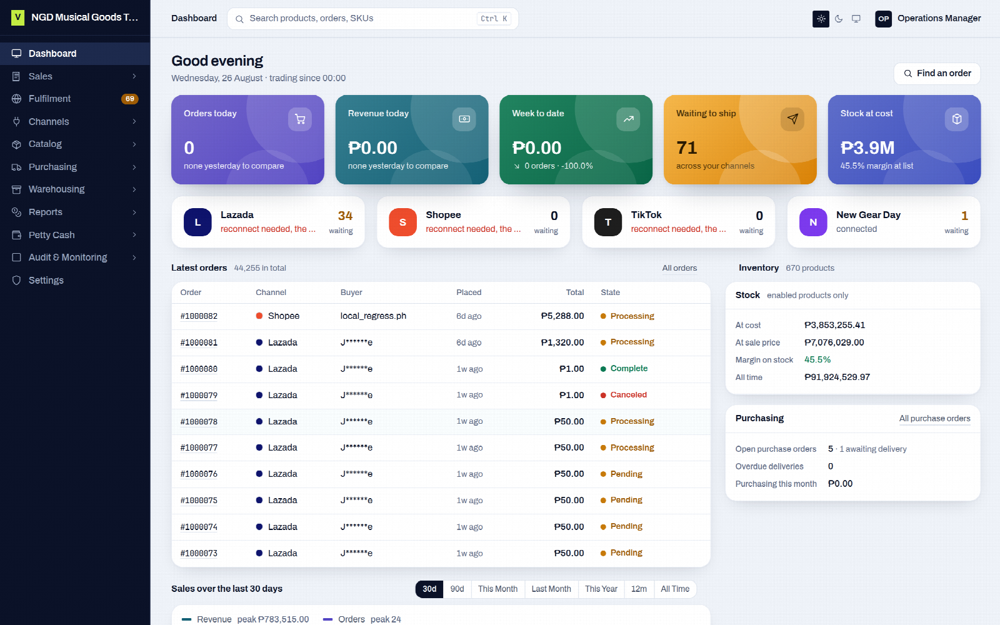

# VentaSync

**One ERP for sellers on Shopee, Lazada, TikTok Shop, Shopify, WooCommerce, OpenCart and Venta.**

One catalog pushed to every store, every order in one list with its profit, stock deducted as orders come in, and purchasing, warehousing and reports on the same data. Open source, self-hosted, your data on your server.



Website: [ventasync.com](https://ventasync.com)

## Server requirements

- PHP 8.2 or newer with `bcmath`, `ctype`, `curl`, `dom`, `fileinfo`, `gd`, `intl`, `mbstring`, `openssl`, `pdo_mysql`, `tokenizer`, `xml`, `zip`
- MySQL 8.0+ or MariaDB 10.6+
- Composer 2
- nginx or Apache, with the document root on `public/`
- Cron, to run the scheduler every minute
- A public domain with HTTPS, so the marketplaces can send sellers back after they connect a store

## Install

```bash
git clone https://github.com/VentaVerse/VentaSync.git ventasync
cd ventasync
composer install --no-dev --optimize-autoloader

cp .env.example .env        # set APP_URL and the DB_ values
php artisan key:generate
php artisan migrate --force --seed
php artisan storage:link
chmod -R 775 storage bootstrap/cache
```

Add the scheduler to cron. Order syncs, stock and price pushes and token refresh all run from it:

```
* * * * * php /path/to/ventasync/artisan schedule:run >> /dev/null 2>&1
```

Open your domain. The first page asks you to create the administrator account. Stores are connected from inside the app.

Web server examples, upgrades and troubleshooting are in [INSTALL.md](INSTALL.md).

## License

[AGPL-3.0-or-later](LICENSE).
